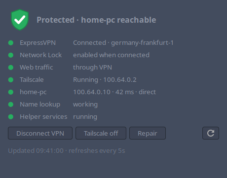
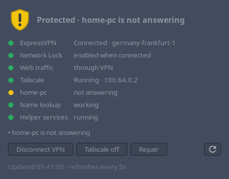
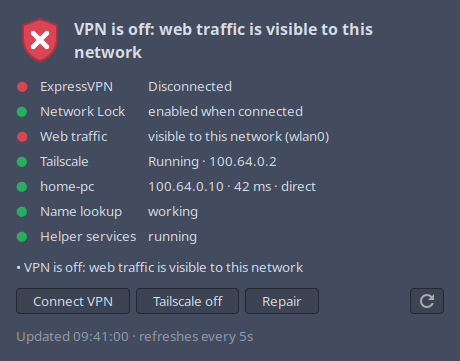
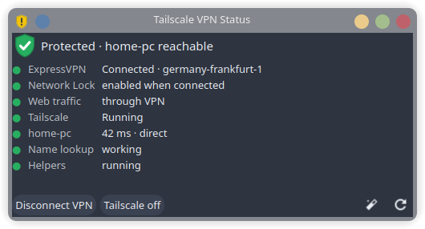

# Tailscale inside ExpressVPN

Lets a Linux machine on an untrusted network reach the devices on your Tailscale network
(your tailnet), with all of its traffic hidden inside ExpressVPN.

It isn't limited to one device. The routing and firewall changes cover Tailscale's whole
address range (`100.64.0.0/10`), so every device listed in `tailscale status` is
reachable, by its Tailscale name or IP. The status app watches one of them, which you
pick in `config.env`. In this README, `<device>` is any device on your tailnet and
`<device-ip>` is its Tailscale IP.

**Not covered:** subnet routes (other networks advertised through a Tailscale subnet
router) and exit nodes. Their addresses are outside `100.64.0.0/10`, so their traffic
still goes into ExpressVPN.

> **Use at your own risk.** `setup.sh` runs as root and changes your routing, firewall
> and VPN settings. Read it before running it, and keep `uninstall.sh` handy. It has
> only been tested on the setup listed below.
>
> Not affiliated with or endorsed by ExpressVPN or Tailscale. Their names are used only
> to describe what this works with.

## Requirements

Tested on:

| Component | Version |
|---|---|
| OS | Ubuntu 26.04 LTS |
| Desktop | KDE Plasma 6.6 (Wayland), for the widget |
| ExpressVPN | Linux app 14.3, with the `expressvpnctl` command, Lightway protocol |
| Tailscale | 1.104 |
| Python | 3.14, with PyGObject, GTK 3, Ayatana AppIndicator and libnotify, for the tray app |

It also assumes:

- systemd, `ufw`, and `iptables` (nftables backend).
- ExpressVPN's tunnel interface is `tun0`, and its firewall chains hook into the
  `filter` table's `OUTPUT` chain. ExpressVPN updates could change either. See
  Troubleshooting.
- Tailscale uses its default routing table (52) and interface (`tailscale0`).

Other distributions or desktops will probably work for the setup scripts. The tray app
needs a desktop with a system tray, and the widget needs Plasma 6.

## Screenshots

Shown with made-up demo data (`python3 app/tsvpn_status.py --demo ok|warn|bad`).

**Status window:** green when everything checks out, yellow when the Tailscale side has
a problem, red when there's a risk of leakage.

| All good | Watched device not answering | VPN off (leak risk) |
|---|---|---|
|  |  |  |

**Plasma widget:**



**Tray icons:**


## Files in this folder

| File | What it does | Needs sudo |
|---|---|---|
| `setup.sh` | Applies the whole setup. Safe to run again. | Yes |
| `uninstall.sh` | Undoes all of it, or only the parts you name. | Yes |
| `check.sh` | Tests that everything is working. | No |
| `README.md` | This file. | |
| `LICENSE` | MIT licence. | |
| `config.example.env` | Template for `config.env`, which picks the device the status app watches. `config.env` is not committed. | |
| `LOCAL.md` | Your own device names and IPs. Not committed. | |

## Privacy

Nothing here sends data anywhere. Every check runs locally: `expressvpnctl`,
`tailscale`, `ip`, `systemctl`, a ping to the watched device over Tailscale, and a name lookup
through Tailscale's own DNS. The app writes no logs or files, apart from a lock file in
`$XDG_RUNTIME_DIR`. Your device names and IPs live only in `config.env` and `LOCAL.md`,
which git ignores, so the repository holds no personal values.

```bash
sh ~/tailscale-over-expressvpn/check.sh
```

## Status app and desktop widget (`app/`)

| File | What it is |
|---|---|
| `app/tsvpn_status.py` | Status checker shared by both. Prints JSON; no sudo. |
| `app/tsvpn_tray.py` | Tray app: shield icon, status menu, status window, notifications. |
| `app/plasmoid/` | Plasma 6 widget for the desktop or panel. |
| `app/install-app.sh` | Installs or updates both, for your user only. `sh install-app.sh remove` uninstalls. |

**Tray app:** a shield in the system tray (it may be under the ^ arrow). Its colour:

| Colour | Meaning | Examples |
|---|---|---|
| Green ✓ | Everything checks out | VPN on, web traffic through it, watched device answering, helpers running |
| Yellow ! | Your traffic is protected, but something on the Tailscale side isn't working | Tailscale stopped, watched device not answering, a helper service down, name lookup failing, VPN reconnecting while Network Lock blocks traffic |
| Red ✗ | Risk of leakage: web traffic is not going through the VPN | ExpressVPN off or disconnected, or it says it's connected but traffic goes out another way |

Red is decided by one check: whether internet traffic from this machine is routed into
ExpressVPN's tunnel (`tun0`). The icons are in `app/icons/`.

Click the shield for the menu, or open **Tailscale VPN Status** from the app launcher for the full window. It
starts at login and sends a notification when the VPN connects or drops, or
the watched device stops or starts answering.

**Widget:** right-click the desktop or panel, then **Add Widgets**, and search for
**Tailscale VPN Status**. On the desktop it shows the full status; on a panel it shows
the shield, and clicking it opens the details.

Both refresh every 5 seconds and have the same buttons:

- **Connect/Disconnect VPN:** `expressvpnctl connect` / `disconnect`
- **Tailscale on/off:** `tailscale up` / `down`
- **Repair:** restarts the two helper services. It asks for your password.

The app watches one device: `TSVPN_HOST` in `config.env` (copy `config.example.env` to
start). If it's empty, the first Tailscale device found is used. Your other devices work
just the same; the app just doesn't show them. After moving this folder, run
`sh app/install-app.sh` again, because the widget and launcher store its path.

## How it works

```
apps ──► tailscale0 ──(WireGuard)──► ExpressVPN tun0 ──► Wi-Fi ──► ExpressVPN server ──► internet ──► any tailnet device
web  ─────────────────────────────► ExpressVPN tun0 ──► Wi-Fi ──► ExpressVPN server ──► internet
```

- All traffic leaving the machine goes through ExpressVPN. The local network only sees
  encrypted traffic to an ExpressVPN server, with no sign of Tailscale.
- Traffic to your Tailscale devices is encrypted twice: by Tailscale end to end, then by
  ExpressVPN.
- Tailscale connects through its relay servers ("via DERP" in `tailscale ping`) rather
  than directly, because ExpressVPN blocks the traffic Tailscale uses for direct links.
  This works fine, but large transfers are slower than at home.

## Your daily routine

Nothing. Start the machine: ExpressVPN connects, Tailscale comes up inside it, and every
device on your tailnet is reachable by its Tailscale name or IP. The only manual step is a hotel or café login
page: log in, let ExpressVPN connect, then browse.

## What was changed, and why

### 1. ExpressVPN settings

| Setting | Before | Now | Why |
|---|---|---|---|
| `autoconnect` | false | **true** | Connects at startup. |
| `background` | (unknown) | **enabled** | Needed for auto-connect without the app window open. |
| `allowlan` | true | **false** | Stops other devices on the local network reaching this machine. |
| `networklock` | false ("enabled when connected") | **false** ("enabled when connected") | Unchanged in the end. Blocks traffic if the VPN drops, but you can still disconnect on purpose. |

The `networklock` value is confusing: `false` shows as "enabled when connected" in
`expressvpnctl status`, and `true` shows as "always enabled", which means no internet
at all whenever the VPN is off.

### 2. Routing rule: `tailscale-over-vpn.service`

- Unit: `/etc/systemd/system/tailscale-over-vpn.service`
- Adds `ip rule … to 100.64.0.0/10 lookup 52 priority 60` (and the IPv6 equivalent for
  `fd7a:115c:a1e0::/48`) at every boot.
- **Why:** ExpressVPN's routing rule (priority 102) sends everything into its tunnel,
  and runs before Tailscale's own rule (priority 5270). Without this rule, traffic for
  `100.x` addresses goes into ExpressVPN instead of Tailscale. Table 52 is Tailscale's.
- Tailscale's own encrypted packets are not `100.x`, so they still go through
  ExpressVPN.
- Has no effect when ExpressVPN is off.

### 3. Firewall guard: `tailscale-vpn-guard.service`

- Unit: `/etc/systemd/system/tailscale-vpn-guard.service`
- Script: `/usr/local/sbin/tailscale-vpn-guard`
- Keeps `iptables -I OUTPUT 1 -o tailscale0 -j ACCEPT` (and the `ip6tables` equivalent)
  as the first rule, re-checking every 5 seconds.
- **Why:** while ExpressVPN is connected, Network Lock rejects all outgoing traffic not
  going into `tun0`, in either mode. That blocked every app's connection to
  tailnet devices and Tailscale's DNS (`100.100.100.100`). ExpressVPN rebuilds its firewall
  on every reconnect, which would push a one-off rule below its block, so the guard
  puts it back on top.
- ExpressVPN has no built-in way to allow this. Its "Allow LAN" setting was tested and
  doesn't cover Tailscale's addresses. Split tunnelling would take Tailscale out of the
  VPN, and wouldn't fix this anyway.
- Only traffic to your own Tailscale devices is allowed. Everything else is still forced
  through ExpressVPN.

### 4. Firewall: ufw

- Default deny incoming, allow outgoing, allow incoming on `tailscale0`, enabled at boot.
- **Why:** a VPN protects traffic leaving the machine, but doesn't stop devices on the
  same Wi-Fi from connecting to it. Your Tailscale devices can still connect.

### 5. Tailscale

- `tailscaled` enabled at boot, and `tailscale up`.
- Operator set to your user, so `tailscale up` and `tailscale down` work without sudo.

## Turning things on and off

For now (back on at the next boot):

```bash
tailscale down
```
```bash
expressvpnctl disconnect
```
```bash
expressvpnctl connect
```
```bash
tailscale up
```

For good (no longer start at boot):

```bash
expressvpnctl set autoconnect false
```
```bash
sudo systemctl disable --now tailscaled
```

Without ExpressVPN your web traffic is visible to the local network again. Your
connections to tailnet devices stay encrypted by Tailscale either way.

## Undoing the setup

```bash
sudo sh ~/tailscale-over-expressvpn/uninstall.sh
```

Or undo only some parts: `guard`, `routing`, `firewall`, `expressvpn`, `tailscale`.

```bash
sudo sh ~/tailscale-over-expressvpn/uninstall.sh guard routing
```

Removing `guard` or `routing` while you still use ExpressVPN and Tailscale together
breaks access to your tailnet devices again. Re-apply with `sudo sh setup.sh`.

## Troubleshooting

Run `check.sh` first. Then:

| Symptom | Likely cause | Fix |
|---|---|---|
| `<device>` doesn't answer, `tailscale ping` does | Guard not running, so Network Lock blocks apps | `sudo systemctl restart tailscale-vpn-guard` |
| `ip route get <device-ip>` shows `tun0` | Routing rule missing | `sudo systemctl restart tailscale-over-vpn` |
| No internet after disconnecting ExpressVPN on purpose | Network Lock set to "always enabled" | `sudo expressvpnctl set networklock false` |
| `<device>` doesn't resolve | Tailscale DNS blocked or Tailscale down | Use `<device-ip>`, then check the guard and `tailscale status` |
| "Unable to connect to the coordination server" right after boot | Tailscale started before the VPN was ready | Usually clears itself within a minute |
| Remote Desktop or SSH times out, ping works | That device isn't allowing it | Enable the service on that device and allow it through its firewall |

Useful commands:

```bash
expressvpnctl status
```
```bash
tailscale status
```
```bash
ip rule
```
```bash
ip route get <device-ip>
```
```bash
sudo iptables -S OUTPUT | head -3
```

## Reference

Your own device names and Tailscale IPs go in `LOCAL.md`, which git ignores.
Get them with `tailscale status` and `tailscale ip <device>`.

## Remaining risks

- **Captive portals:** traffic is unprotected while you log in, before ExpressVPN connects.
- **Boot gap:** with Network Lock on "enabled when connected", there are a few seconds at
  boot before ExpressVPN connects.
- **Visible metadata:** the network can see that you use a VPN, how much traffic you
  send, and this machine's MAC address and hostname.
- **Trust in ExpressVPN:** it sees which websites you visit, but can't read your Tailscale
  traffic.
- **ExpressVPN updates** could change its firewall chain names or rule layout. If
  tailnet devices stop answering after an update, check the guard first.
